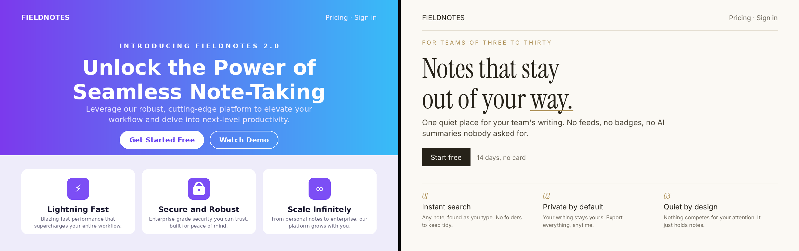

# SkillPort


    

**Your AI is running bare. Give it skills.**

New from the same workshop: [SkillDoctor](https://github.com/Dongdarealest/skilldoctor) audited 777 skills from the six biggest public collections, and one in three failed. [Read the audit](https://github.com/Dongdarealest/skilldoctor/blob/main/AUDIT.md).

<p align="center">
  <a href="https://github.com/Dongdarealest/skilldoctor/blob/main/REGISTRY.md"></a>
</p>

SkillPort itself sits in the SkillDoctor [registry](https://dongdarealest.github.io/skilldoctor/): every skill in the collection passes with 0 failures. The plaque above is served live from the registry and re-verified daily, so the score on its face is the current one, not a snapshot.

[Live demo](https://dongdarealest.github.io/skillport/) · [Packs](#packs) · [Install](#install) · [Catalog](#catalog) · [For authors](#for-authors-the-converter) · [Philosophy](#philosophy)

## Contents

- [What is a skill?](#what-is-a-skill)
- [How it works](#how-it-works)
- [Packs](#packs)
- [Install](#install)
- [Catalog](#catalog)
- [For authors: the converter](#for-authors-the-converter)
- [Updating](#updating)
- [Philosophy](#philosophy)
- [Community](#community)
- [Contributing](#contributing)
- [License](#license)

## What is a skill?

A skill is a small folder of instructions an AI loads when a task matches, so it works the way a specialist would instead of improvising like a generalist. The same model, with a good skill loaded, writes cleaner, designs with more taste, and reviews code like it has done it for years. Without one, every answer starts from zero, and you can tell: the output sounds and looks generated.

Every platform invented its own skill format, so a skill written for one AI will not install on another. That lock-in is the problem SkillPort removes.

## How it works

Pick a pack built for the work you do. Install it with one line. From then on, your AI quietly carries those skills into every matching task: ask for a landing page and the design skills shape it, ask for an email and the writing skills take the sales voice out, ask for a review and the coding skills check what a senior would check. You do not invoke anything. The skills are simply there, the way experience is there for a person.

Same AI. Same brief. The only difference is a skill pack.



## Packs

| Pack | What your AI learns | Download |
|---|---|---|
| [Human Touch Pack](packs/human-touch-pack/) | **Flagship.** Output that looks human-made, not generated | [ZIP](https://github.com/Dongdarealest/skillport/releases/download/v0.3.6/human-touch-pack.zip) |
| [Design Pack](packs/design-pack/) | A designer's eye | [ZIP](https://github.com/Dongdarealest/skillport/releases/download/v0.3.6/design-pack.zip) |
| [Writing Pack](packs/writing-pack/) | To write like a person | [ZIP](https://github.com/Dongdarealest/skillport/releases/download/v0.3.6/writing-pack.zip) |
| [Coding Pack](packs/coding-pack/) | A senior engineer's habits | [ZIP](https://github.com/Dongdarealest/skillport/releases/download/v0.3.6/coding-pack.zip) |
| [ShipSafe Pack](packs/shipsafe-pack/) | To check before it trusts, and to undo what went wrong | [ZIP](https://github.com/Dongdarealest/skillport/releases/download/v0.3.6/shipsafe-pack.zip) |

## Install

One line installs a whole pack. Swap the pack name and the last word for your AI.

### Claude

```bash
curl -fsSL https://raw.githubusercontent.com/Dongdarealest/skillport/main/install.sh | bash -s -- human-touch-pack claude
```

On Windows, in PowerShell:

```powershell
irm https://raw.githubusercontent.com/Dongdarealest/skillport/main/install.ps1 -OutFile install.ps1
.\install.ps1 human-touch-pack claude
``` Using Claude on the web instead? Zip any single skill folder inside a pack's `for-claude/` folder and upload it under Settings, Skills.

### Cursor

Run the same line with `cursor` as the last word, from inside your project. The pack's rules land in `.cursor/rules/`.

### Codex

Run the same line with `codex` as the last word, from inside your project. The pack is appended to your `AGENTS.md`.

### ChatGPT

ChatGPT has no skills folder. Download a pack ZIP, open `for-chatgpt/`, and paste each file into your custom GPT or project instructions.

### By hand

Every pack is a ZIP download in the table above. Unzip it, open the folder for your AI, and copy its contents where that AI keeps its skills or rules. Each pack's own README says exactly where, one line per platform.

## Catalog

### Human Touch Pack

- **human-voice**: rewrites AI text so it reads like a specific person wrote it. No filler openings, no buzzwords, no metronome rhythm.
- **anti-slop-design**: designs pages that do not look generated. No purple gradient hero, no identical card grid, no default type at default sizes.
- **make-it-real**: forces specifics over filler. Real numbers, named examples, insider detail, a stated point of view.

### Design Pack

- **interface-craft**: art direction for interfaces. Composition, type, color and detail, in that order.
- **hero-section**: a first screen a stranger understands in five seconds.
- **color-system**: a small disciplined palette. Tinted neutrals, one accent, rules for where each may appear.

### Writing Pack

- **clear-writing**: prose that reads like a person talking. One idea per sentence, verbs early, endings that land.
- **headline-hook**: headlines that earn the next ten seconds without clickbait.
- **warm-email**: cold emails and replies that sound like one person writing to another.

### Coding Pack

- **code-review**: a review that finds real risk, in severity order, and says plainly when the code is fine.
- **commit-craft**: commit messages and pull requests that explain why, not only what.
- **readme-craft**: a README a stranger understands within one screen.

### ShipSafe Pack

- **vet-before-install**: vets a third-party skill or prompt pack before it is installed. An automated audit with SkillDoctor first, then the human checks for authority claims, outbound actions and credential reach.
- **secrets-out**: scrubs credentials, tokens, personal data and private paths out of anything before it is pasted, committed or sent. Replace, do not just delete, and rotate what already leaked.
- **backup-before-change**: makes a restore point of skills, configs and dotfiles before an agent edits them, and rolls back the whole folder when an edit goes wrong.

## For authors: the converter

Writing your own skill? Start from the [template](template/SKILL.md), write it once as a Claude-style `SKILL.md`, and let SkillPort compile it for every platform.

The fastest way is the [live demo](https://dongdarealest.github.io/skillport/): paste a `SKILL.md`, get every package back, nothing to install. In the terminal:

```bash
node src/skillport.mjs your-skill/SKILL.md dist
```

It produces all four packages plus a `PORT.md` manifest. Differences that cannot travel, such as `allowed-tools`, are reported in the manifest, never silently dropped. Folder assets (scripts, references) are copied for the Claude target and listed for the rest. No dependencies, Node 18 or newer. Four worked examples live in [`examples/`](examples/), including a data skill with scripts and references.

## Updating

Run the install line again. The newest pack replaces the old one in place, and your own files are never touched.

## Philosophy

1. **The skill is the source of truth.** Platforms are compile targets. A good skill should reach everyone, not one vendor's users.
2. **Ready beats configurable.** Most people do not want to assemble anything. Packs install in one line and work immediately.
3. **Honest conversion.** What cannot travel between platforms is reported, never silently dropped.

## Community

Questions, ideas and skill requests belong in [Discussions](https://github.com/Dongdarealest/skillport/discussions). Bugs belong in [Issues](https://github.com/Dongdarealest/skillport/issues). If a pack changed your output, the most helpful thing you can share is a before and after.

## Support

SkillPort is free and MIT licensed. If it made your AI noticeably better, a coffee keeps the next pack coming.

<p>
  <a href="https://github.com/sponsors/Dongdarealest"></a>
  <a href="https://ko-fi.com/dongdarealest"></a>
</p>

## Contributing

New packs and new skills are the most welcome contributions. Start from the [template](template/SKILL.md), keep each skill small, original and genuinely usable, and run `python3 build_packs.py` so every pack still ships all four targets. The CI workflow checks this on every pull request.

## License

MIT
